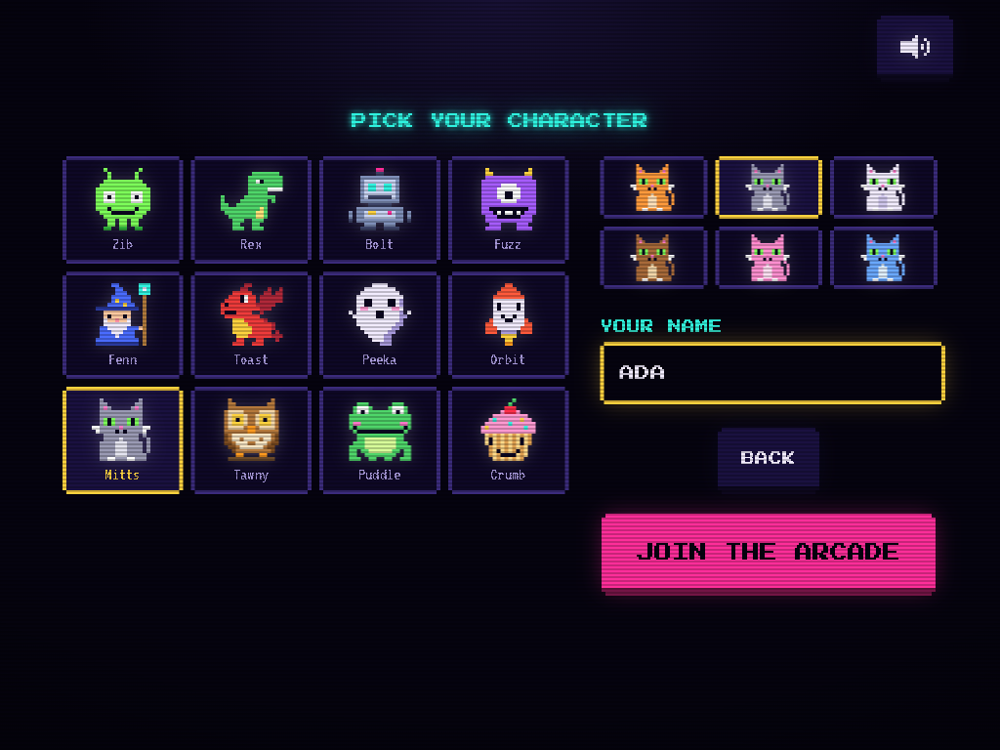
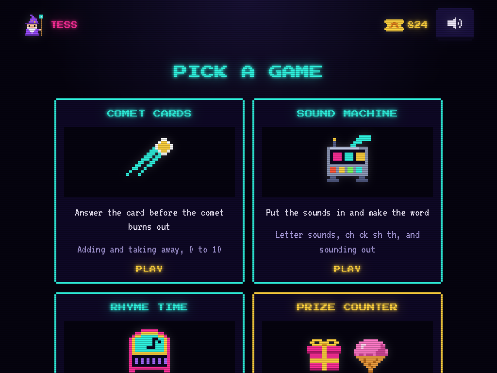

<h1 align="center">Schoolhouse Arcade</h1>

<p align="center"><b>A retro coin-op arcade of small learning games.</b></p>
<p align="center">Each cabinet drills one idea until recall is fast. Playing earns tickets and badges that a grown-up trades for real prizes.</p>

<p align="center">
  
  
  
  
  <a href="LICENSE"></a>
  
</p>

<p align="center">
  <!-- Stand-in: replace with docs/hero.png once it is generated from docs/hero-image-prompt.md -->
  
  <br>
  <sub><i>Press start: twelve characters, one arcade, and a strip of tickets to win.</i></sub>
</p>

## Features

An arcade for a first-grader, played on a tablet over home Wi-Fi and served
from a Mac. The look is an early-80s tube: black glass, scanlines, cyan,
magenta and yellow. [`docs/PRD.md`](docs/PRD.md) has the whole design.

<table>
  <tr>
    <td width="50%" valign="top">
      
      <br><sub><i>Pick a character, then its colour, then type a name.</i></sub>
      <h3>Twelve characters, no logins</h3>
      <p>A player is a name and a pixel character: an alien, a dinosaur, a robot, a monster, a wizard, a dragon, a ghost, a rocket, a cat, an owl, a frog or a cupcake, each in six colours. Tickets, badges and unlocked levels belong to the player; the high score tables show everyone.</p>
    </td>
    <td width="50%" valign="top">
      
      <br><sub><i>The floor: one cabinet so far, and more on the delivery truck.</i></sub>
      <h3>An arcade floor</h3>
      <p>Each cabinet drills one idea until recall is fast. The first is <b>Comet Cards</b>: adding and taking away, 0 to 10. New cabinets plug into the same players, tickets and badges.</p>
    </td>
  </tr>
  <tr>
    <td width="50%" valign="top">
      
      <br><sub><i>A Sprint round on Easy: one card, four answers, a combo building.</i></sub>
      <h3>Flashcards against the clock</h3>
      <p>Answer the card before the comet burns out. Easy offers four answers to pick from; Arcade has you type it. A wrong answer shows the right one and never takes away anything already earned, and cards a player has missed come round more often.</p>
    </td>
    <td width="50%" valign="top">
      
      <br><sub><i>Five levels, four ways to play, two skills.</i></sub>
      <h3>Levels and modes</h3>
      <p>Five levels from Add to 5 up to Big Sums; a star on one opens the next. Blitz is 60 seconds, Sprint is 20 cards, Survival is three lives, and Practice has no clock at all. Every combination keeps its own high score table.</p>
    </td>
  </tr>
  <tr>
    <td width="50%" valign="top">
      
      <br><sub><i>After a round: stars, tickets, and where it landed on the table.</i></sub>
      <h3>Stars, tickets and badges</h3>
      <p>Every right answer pays tickets; stars, badges and beating your own best pay more. The Mac keeps score: a game sends its answers, and the server works out the score, the tickets and the badges, once per round.</p>
    </td>
    <td width="50%" valign="top">
      
      <br><sub><i>The Prize Counter: what the tickets can buy today.</i></sub>
      <h3>A Prize Counter for real prizes</h3>
      <p>A grown-up stocks the shelf (a candy, an ice cream, a new video game) and sets the prices. Handing a prize over, changing tickets by hand, opening a level and retiring a player all take a four-digit grown-up PIN, checked on the Mac every time.</p>
    </td>
  </tr>
</table>

The grown-up PIN is chosen on the Mac: open `http://localhost:38900` there
and go to *Grown-ups*. Forgotten it? `npm run pin:reset` at the Mac, then
choose a new one the same way.

## Run it

```sh
brew install postgresql@17 && brew services start postgresql@17
npm install && npm --prefix web install
npm run db:setup
npm run dev
```

Then open `http://localhost:38900` on the Mac, or the *Network* address Vite
prints on a tablet on the same Wi-Fi. On an iPad, *Share → Add to Home
Screen* opens it full screen.

The server answers only this machine, private network addresses and `.local`
names. `ARCADE_LOCAL_ONLY=1 npm run dev` keeps it to this machine.

**Over Tailscale.** The Mac's Tailscale address (`http://100.x.y.z:38900`)
works as it is. For an https name as well, serve the app on **another** port
and tell the app its name (in `.env.local` at the repo root, so the Mac app
sees it too), then restart:

```sh
tailscale serve --bg --https=8900 http://localhost:38900
echo 'ARCADE_TAILNET_HOST=my-mac.my-tailnet.ts.net' >> .env.local
```

Then it is `https://my-mac.my-tailnet.ts.net:8900`. Never serve it on 38900
itself: Tailscale then holds that port on the Mac's Tailscale address, and
the app, which listens on every address, fails to start ("Port 38900 is
already in use").

Only that exact name is answered, never a pattern. Setting up the first PIN
still has to be done at the Mac itself.

### Mac app

`./macos/build-app.sh` installs *Schoolhouse Arcade.app*: click it in the
Dock to start the server and open the arcade in Chrome; quit it to stop the
server. See [`macos/README.md`](macos/README.md). `npm run db:backup` copies
the database into `backups/` ([`docs/DATA.md`](docs/DATA.md) has restore
and an optional daily job).

## Develop

```sh
npm test                           # shared rules, routes, database (in-process PGlite)
npm run typecheck && npm run lint
```

- [`docs/PRD.md`](docs/PRD.md): what was decided, and how to add a cabinet
- [`docs/DATA.md`](docs/DATA.md): what is stored where, changing the schema
- [`docs/ART.md`](docs/ART.md): how the pixel sprites are written and replaced
- [`CLAUDE.md`](CLAUDE.md): the rules that keep it working

## Licence

AGPL-3.0-only. All art, names and sounds are original.
